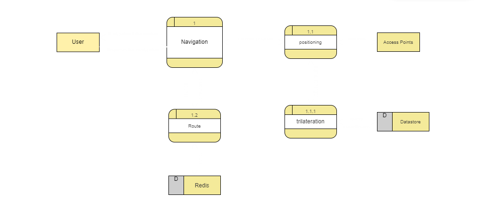

<div align="center">

# 🛰️ Indoor Navigation System

**Wi-Fi/BLE based indoor positioning and navigation, powered by RSSI trilateration.**

[](https://nodejs.org/)
[](https://www.mongodb.com/)
[](https://redis.io/)
[](https://docs.docker.com/compose/)
[](https://jestjs.io/)
[](https://circleci.com/)
[](LICENSE)

[Live API Docs (Swagger)](https://indoor-navigation-system.onrender.com/api-docs) ·
[Presentation](https://www.canva.com/design/DAGJBla4D8E/CSQXnvb7xHmudXmcs_kQYQ/edit) ·
[SRS](docs/SRS.md) ·
[Proposal](docs/Proposal.docx)

</div>

---

## 📖 Table of Contents

- [Overview](#-overview)
- [Problem & Solution](#-problem--solution)
- [Features](#-features)
- [Tech Stack](#-tech-stack)
- [System Design](#-system-design)
- [Requirements Summary](#-requirements-summary)
- [Use Cases](#-use-cases)
- [Data Example](#-data-example)
- [API Documentation](#-api-documentation)
- [Getting Started](#-getting-started)
- [Environment Variables](#-environment-variables)
- [Testing](#-testing)
- [Project Structure](#-project-structure)
- [Documentation](#-documentation)
- [License](#-license)

---

## 🔭 Overview

Outdoors, a position is determined through global satellite navigation systems. Indoors, GPS signals are often unavailable, and there is still no single positioning standard that fits every environment.

**Indoor Navigation System** is a backend that determines a user's location inside a building using **trilateration** over **RSSI values** measured from nearby access points / beacons, then guides the user to a destination. **Organizations** can upload their floor plans in **GeoJSON** format and associate them with their access points.

It is designed for environments such as shopping malls, airports, hospitals and office buildings.

---
## 📽️ Presentation
[View the Presentation on Canva](https://www.canva.com/design/DAGJBla4D8E/CSQXnvb7xHmudXmcs_kQYQ/edit)

## 💡 Problem & Solution

An indoor navigation system needs two things:

1. **A map of the indoor environment** — the layout of the space and its key features such as rooms and hallways.
2. **Sensors** — objects that collect data to determine the user's location, such as Wi-Fi access points or Bluetooth beacons.

**Core idea**

- Use Wi-Fi access points as sensors throughout the building.
- Create a detailed map with the coordinates of each point.
- Build a dataset that links point coordinates to the signal strength of nearby access points.

**How a user is located:** the user's device sends the measured signal strengths to the system, which resolves the position from them.

**Keeping accuracy high:** components of an indoor environment change over time and affect stored signal strength, which lowers accuracy. To avoid this, the system:

- Does **not** scan the entire area. It only defines **reference points** that never change.
- Relates access points only to those reference points.
- Records the reference points together with their signal strength.

This makes the main components fixed, but leaves a gap between stored points. A dynamic localization technique, **trilateration**, fills that gap.

---

## ✨ Features

- 🔐 **Authentication & user management** — register, log in and log out securely.
- 📍 **Trilateration-based indoor positioning** using RSSI values from beacons.
- 🗺️ **GeoJSON map representation** for storing and visualizing floor plans.
- 🏢 **Multi-organization support** — each organization manages its own maps and access points.
- 🧭 **Real-time navigation** — position is updated continuously as the user moves.
- ⚡ **Redis caching** for fast responses.
- 📚 **Swagger API documentation** for exploring and testing endpoints.
- 🐳 **Docker Compose support** for easy deployment.
- ✅ **Automated tests and CI** with Jest and CircleCI.

---

## 🧰 Tech Stack

| Layer | Technology |
| --- | --- |
| Backend | Node.js (Express.js) |
| Database | MongoDB (containerized) |
| Caching | Redis |
| Logging | Winston |
| Email | SendGrid |
| Containerization | Docker & Docker Compose |
| CI/CD | CircleCI |
| Testing | Jest |
| API Docs | Swagger |

---

## 🏗️ System Design

The system consists of a backend server for data processing and storage and a database for mapping information. Positioning calculations are performed on the backend. Clients communicate with the server over HTTP and WebSocket.

### Context Diagram

The system interacts with two external entities: the **User** and the **Access Points**.

<p align="center">
  
</p>

### Data Flow Diagram (DFD)

The **Navigation** process is split into **Positioning** (which uses **Trilateration**) and **Route** calculation. **Redis** and the main **Datastore** back these processes.

<p align="center">
  
</p>

---

## 📋 Requirements Summary

The complete specification lives in [`docs/SRS.md`](docs/SRS.md). Highlights:

**User classes**

- **End users** — people who use the app to get navigation help.
- **Administrators** — manage and maintain the backend infrastructure.
- **Developers** — build, test and maintain the system.

**Functional requirements**

| Area | Requirement |
| --- | --- |
| Authentication | Users can create accounts, log in and log out securely. |
| Create map | Convert a drawn map to GeoJSON so it can be represented in any technology. |
| Positioning | Collect Wi-Fi signal data from the user's device and determine position with trilateration. Target accuracy: **within 2 meters**. |
| Navigation | Update the user's position in real time and show directions in a user-friendly format such as visual maps. |

**Non-functional requirements**

| Area | Requirement |
| --- | --- |
| Performance | Respond to queries with minimal latency (**at most 500 ms**), perform positioning efficiently on the backend, and support concurrent users without performance loss. |
| Reliability | Be resilient to failures, recover gracefully from errors, and show clear error messages to users. |

---

## 🧑‍💻 Use Cases

### User registration

**Goal:** the user is registered and logged in.

1. The user launches the app and selects the register option.
2. The user provides the required information (username, email, password, ...).
3. The user submits the registration form.
4. The system validates the information.
5. If validation succeeds, the system creates the account.
6. The user receives a confirmation message and is logged in automatically.

### Navigation

**Goal:** the user has a planned route to the destination.

1. The user launches the app.
2. The user enters the starting point and the destination.
3. The system calculates the optimal route from the current location to the destination.
4. The system provides navigation directions to the user.

---

## 📊 Data Example

Sample reference data: RSSI readings (dBm) from six access points at known normalized coordinates.

| # | AP1 | AP2 | AP3 | AP4 | AP5 | AP6 | x | y |
| --- | --- | --- | --- | --- | --- | --- | --- | --- |
| 0 | -37 | -36 | -36 | -32 | -33 | -61 | 0.548814 | 0.715189 |
| 1 | -35 | -35 | -35 | -41 | -41 | -70 | 0.544883 | 0.423655 |
| 2 | -30 | -36 | -32 | -40 | -35 | -61 | 0.645894 | 0.437587 |
| 3 | -41 | -42 | -43 | -42 | -41 | -56 | 0.891773 | 0.963663 |
| 4 | -44 | -44 | -44 | -35 | -36 | -53 | 0.383442 | 0.791725 |

---

## 📡 API Documentation

Interactive Swagger UI: **[indoor-navigation-system.onrender.com/api-docs](https://indoor-navigation-system.onrender.com/api-docs)**

When running locally, the same documentation is served at `/api-docs` on your configured port.

---

## 🚀 Getting Started

### Prerequisites

- [Docker](https://docs.docker.com/get-docker/) & Docker Compose
- [Node.js](https://nodejs.org/) & npm

### Installation

1. **Clone the repository**

   ```sh
   git clone https://github.com/OsamaElshaer/Indoor-Navigation-System.git
   ```

2. **Navigate to the project directory**

   ```sh
   cd Indoor-Navigation-System
   ```

3. **Configure environment variables** — create a `.env` file as described [below](#-environment-variables).

4. **Start the application**

   ```sh
   docker-compose up -d
   ```

The repository also includes `docker-compose.dev.yml` and `docker-compose.prod.yml` for environment-specific setups.

---

## 🌍 Environment Variables

Create a `.env` file in the root directory:

```ini
# Server Configuration
PORT=4000                      # Port the application runs on
WHITE_LIST="*"                 # Allowed origins for CORS

# Email Configuration
EMAIL="your-email@example.com"             # System admin email
SENDGRID_API_KEY="your-sendgrid-api-key"   # SendGrid API key for sending email
MAILTRAP_USER="your-mailtrap-username"     # Mailtrap sandbox username
MAILTRAP_PASS="your-mailtrap-password"     # Mailtrap sandbox password

# Database Configuration
DB_HOST="mongodb://your-mongodb-host:27017"   # MongoDB connection string
REDIS_HOST="redis://your-redis-host:6379"     # Redis connection string

# Security & Authentication
JWT_SECRET_KEY="your-secret-key"   # Secret key for JWT authentication

# Application Settings
NODE_ENV="development"             # development | production

# Indoor Positioning Constants
CONSTANTS_INDOOR_ENVIROMENT='{"REFERENCE_DISTANCE":1.5, "PATH_LOSS_EXPONENT":2, "VARIANCE":3}'
# Environmental constants used for trilateration calculations

REFERENCE_RSSI='{"AP1":-45,"AP2":-48,"AP3":-50}'
# RSSI reference values for access points

COORDINATES_OF_AP='{ "AP1": { "x": 2, "y": 3, "z": 20 }, "AP2": { "x": 15, "y": 9, "z": 20 }, "AP3": { "x": 11, "y": 15, "z": 20 } }'
# Physical coordinates of access points in 3D space

SERVER_URL="https://your-server-url.com/keep-alive"
# Public URL of the server
```

> ⚠️ Never commit your real `.env` file or secrets (`JWT_SECRET_KEY`, `SENDGRID_API_KEY`, ...) to version control.

---

## 🧪 Testing

Tests are written with **Jest** and live in the `__test__` folder.

```sh
npm test
```

Continuous integration runs on **CircleCI** (see `.circleci`).

---

## 📁 Project Structure

```text
.
├── .circleci/               # CI pipeline configuration
├── .vscode/                 # Editor settings
├── __test__/                # Jest tests
├── docs/                    # SRS, proposal and diagrams
├── src/                     # Application source code
├── Dockerfile
├── docker-compose.yml
├── docker-compose.dev.yml
├── docker-compose.prod.yml
├── package.json
└── LICENSE
```

---

## 📚 Documentation

| Document | Description |
| --- | --- |
| [`docs/SRS.md`](docs/SRS.md) | System Requirements Specification: scope, functional and non-functional requirements, use cases and system models. |
| [`docs/Proposal.docx`](docs/Proposal.docx) | Project proposal: problem statement, reference-point approach and the trilateration idea. |
| [`docs/images/`](docs/images) | Context diagram and data flow diagram. |
| [Presentation](https://www.canva.com/design/DAGJBla4D8E/CSQXnvb7xHmudXmcs_kQYQ/edit) | Project presentation on Canva. |

---

## 📄 License

This project is licensed under the **MIT** License. See [LICENSE](LICENSE) for details.
